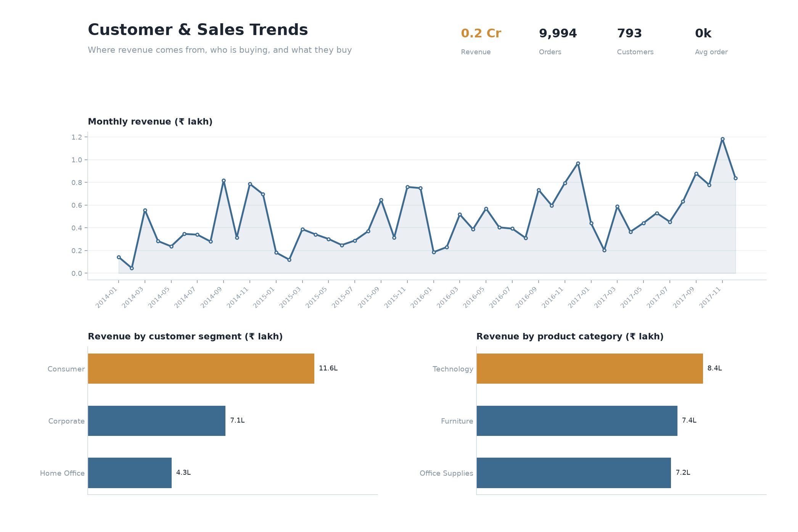
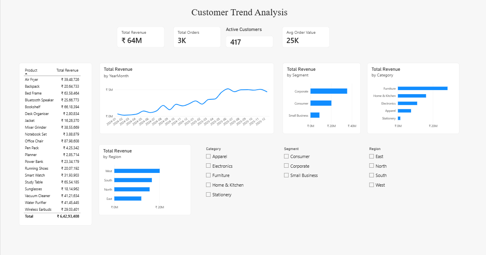

# Customer Trends & Sales Analysis

SQL analysis of customer and sales data, with a dashboard summarising the results.

**The question:** where is revenue coming from, who is buying, and what should the
business do differently?

### Power BI version

An interactive version built in Power BI Desktop, with slicers for region, segment and product category.

The .pbix file is in the repository root.

---

## The data

Two tables, which is how sales data is normally stored:

- **`customers.csv`** — 793 customers, with region, segment and first-order date.
  This dataset doesn't track signups separately, so the date is approximated as
  each customer's earliest recorded order.
- **`orders.csv`** — 9,994 orders, with date, product, category, quantity and revenue.

Because region and segment live on the customer while revenue lives on the order, most
of the analysis needs a **JOIN** between the two.

Source: Kaggle's "Superstore Dataset Final" (real US retail orders). Revenue figures
are in USD, not INR.

Covers January 2014 to December 2017. Total revenue $2,297,200.65.

---

## What I found

**1. Corporate customers are 29.5% of active buyers but bring in 55.1% of revenue.**
123 corporate customers generate ₹3.54 crore of the ₹6.43 crore total. Their average order is ₹43,844 against ₹14,114 for consumers — over three times larger. Consumers place more orders (1,432 vs 808), but small basket sizes dilute their overall impact.

**2. Revenue grew steeply, then flattened.**
Monthly revenue climbed from about ₹4 lakh in early 2024 to ₹50 lakh by mid-2025, then held roughly flat for the last six months. The growth came from the customer base expanding, not from customers spending more — average order value stayed around ₹25,000 throughout. That matters: the growth engine has stalled and nothing has replaced it.

**3. Furniture is nearly half of all revenue.**
₹2.83 crore of ₹6.43 crore comes from one category, driven by high unit prices rather than volume. Stationery sells comparable order counts but brings in ₹13.8 lakh — about 2% of revenue. High order volume in a low-value category is a cost, not a win.

**4. Regional revenue differences are mostly about customer count, not customer quality.**
West leads total revenue (₹2.01 crore), but revenue per active customer is almost identical across West (₹1.59 lakh), South (₹1.60 lakh), and East (₹1.59 lakh). North is the outlier at ₹1.40 lakh. So the regions aren't performing differently — West simply has more customers.

**What I'd recommend:** revenue per customer is close across all four regions
($2,781–$3,000), so regional differences in total revenue mostly come down to how
many customers each region has, not how valuable those customers are. Central and
South have the fewest customers — growing the customer base there looks like a more
direct lever than trying to change regional buying behaviour.

---

## How it works

Queries live in `/queries`, numbered in the order they build on each other.

| File | What it answers |
|---|---|
| `01_revenue_over_time.sql` | How revenue has moved month by month |
| `02_revenue_by_region.sql` | Which regions bring in the most, and per customer |
| `03_customer_segments.sql` | How the three customer types differ |
| `04_product_performance.sql` | Which products lead within their own category |
| `05_top_customers.sql` | Who the most valuable customers are |
| `06_category_by_segment.sql` | Whether different customer types buy different things |

### The SQL, in plain terms

- **`JOIN`** — combines the two tables on `CustomerID`, so customer details and order
  revenue can be looked at together. Used in most queries here.
- **`GROUP BY`** — collapses many rows into one summary row, e.g. one line per region.
- **CTE (the `WITH` block)** — a named temporary result you build first, then query. In
  `04_product_performance.sql` revenue per product is worked out first, then ranked.
- **Window functions** — a calculation across rows that keeps every row visible.
  `RANK() OVER (PARTITION BY Category ...)` ranks products **within** each category rather
  than against the whole catalogue, and `SUM(...) OVER (PARTITION BY Category)` gives each
  product's share of its own category on the same line.

---

## Running it
python prepare_real_data.py # converts the downloaded Kaggle CSV into data/customers.csv and data/orders.csv
python run_analysis.py # loads into SQLite, runs every query, prints results
python build_dashboard.py # writes output/dashboard.png

Needs `pandas` (`pip install pandas`) and the raw Kaggle file saved as
`superstore_raw.csv` in the project folder — download from Kaggle's
"Superstore Dataset Final". SQLite is used for the analysis itself so there's
nothing else to install; the SQL is standard and runs in MySQL Workbench too.

---

## Files
customer-trends-analysis/
├── README.md
├── prepare_real_data.py
├── run_analysis.py
├── build_dashboard.py
├── data/
│ ├── customers.csv
│ └── orders.csv
├── queries/
│ ├── 01_revenue_over_time.sql
│ ├── 02_revenue_by_region.sql
│ ├── 03_customer_segments.sql
│ ├── 04_product_performance.sql
│ ├── 05_top_customers.sql
│ └── 06_category_by_segment.sql
└── output/
└── dashboard.png

---

## Data source

Dataset: Superstore Sales Dataset (Kaggle, vivek468/superstore-dataset-final).
Converted from its original single-file format into this project's customer/order
structure using `prepare_real_data.py`.
